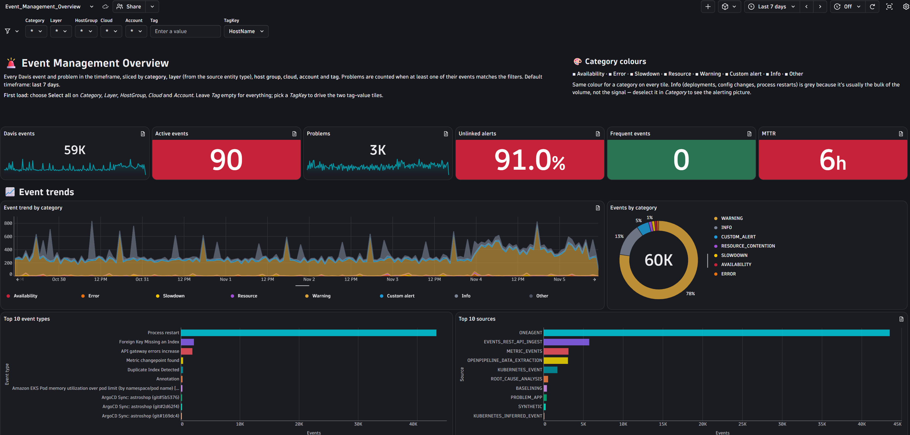
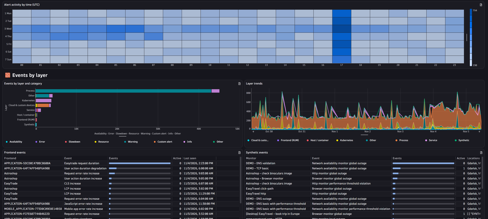
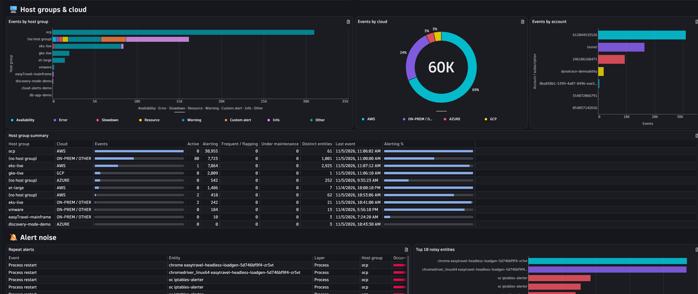
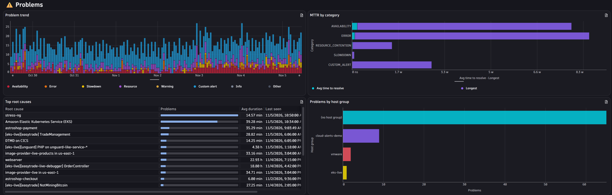
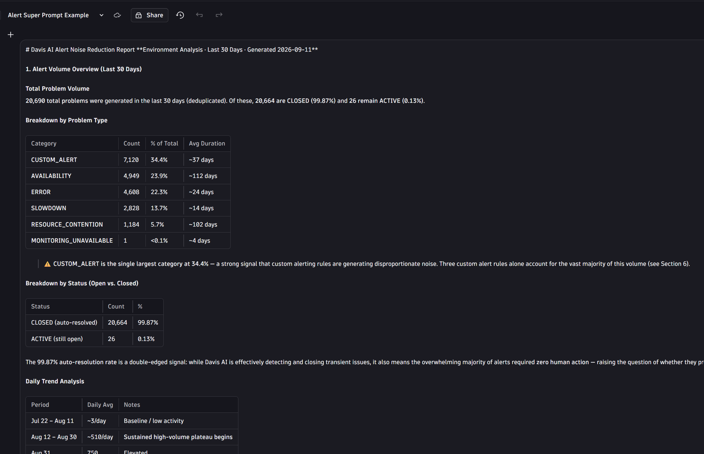
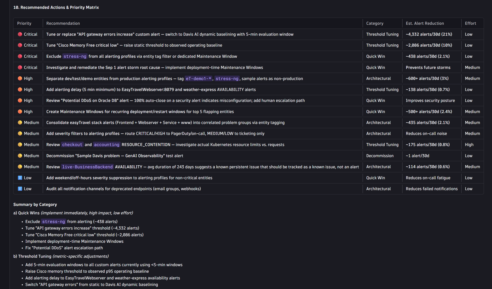
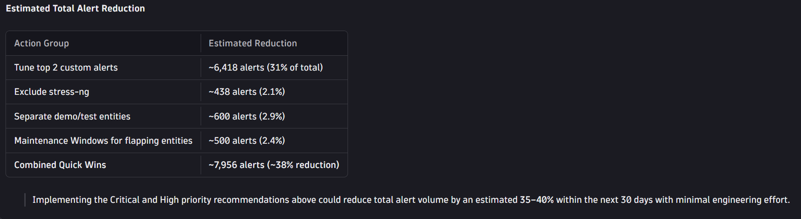

# Event Management Dashboard and Alert Noise Prompt

A Dynatrace dashboard that shows every Davis event and problem in your environment, plus a prompt that turns the last 30 days of alerts into an Alert Noise Reduction Report.

| File | Purpose |
|---|---|
| Event_Management_Overview.json | Event Management Overview dashboard |
| alert_review.txt | Prompt that produces the Alert Noise Reduction Report |

Use them together. The dashboard shows where the noise is. The prompt turns it into a prioritised list of fixes.

## What the dashboard looks like

### Event Management Overview

Headline tiles (Davis events, active events, problems, unlinked alerts, frequent events, MTTR), event trends by category, and the top event types and sources:

Alert activity by hour and weekday, events by layer, and frontend and synthetic events:

Events by host group, cloud and account, plus the alert noise tiles (repeat alerts and top noisy entities):

Problem trend, MTTR by category, top root causes and problems by host group:

The dashboard also has sections for tags (events and problems by tag value, untagged events) and changes (change events and problems after a change). Use the **Category**, **Layer**, **HostGroup**, **Cloud**, **Account** and **Tag** variables to slice everything at once. Each category has the same colour on every tile.

## What the prompt produces

`alert_review.txt` asks for a 10-section report on the last 30 days of Davis problems and events:

1. Alert volume overview
2. Flapping and recurring alerts
3. Short-lived and low-value alerts
4. Top noisy entities
5. Duplicate and correlated alerts
6. Custom alert configuration review
7. Maintenance window and suppression gaps
8. Alerting profile and notification analysis
9. Sensitivity and threshold tuning recommendations
10. Recommended actions and priority matrix

Example output. The volume overview breaks problems down by category, status and daily trend:

The priority matrix ranks each fix by priority, category, estimated alert reduction and effort:

It finishes with the estimated total reduction from the quick wins:

The numbers in the screenshots come from a demo environment. Your results will differ.

## Prerequisites

- A Dynatrace tenant with the Dashboards app.
- Permission to read Davis events and problems.
- For the prompt: an AI assistant with access to your Dynatrace data, for example in a Notebook.

## Upload the dashboard

1. Open the **Dashboards** app.
2. Select **Upload** and choose `Event_Management_Overview.json`.
3. Review the dashboard, then **Save** (and **Share** if others need it).
4. Set the timeframe. The default is the last 7 days.
5. On the first load, choose **Select all** on **Category**, **Layer**, **HostGroup**, **Cloud** and **Account**. Leave **Tag** empty to see everything. Pick a **TagKey** to drive the two tag-value tiles.

## Run the alert noise prompt

1. Open `alert_review.txt` and copy the contents.
2. Paste it into your AI assistant with access to your Dynatrace environment.
3. Review the report. Check the quick wins against the dashboard tiles (repeat alerts, top noisy entities, alert activity by time) before changing any alerting configuration.
