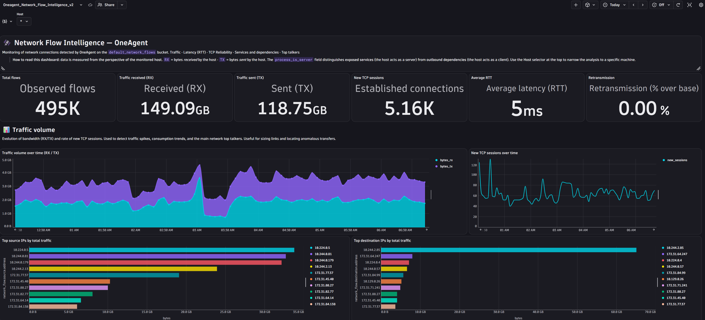
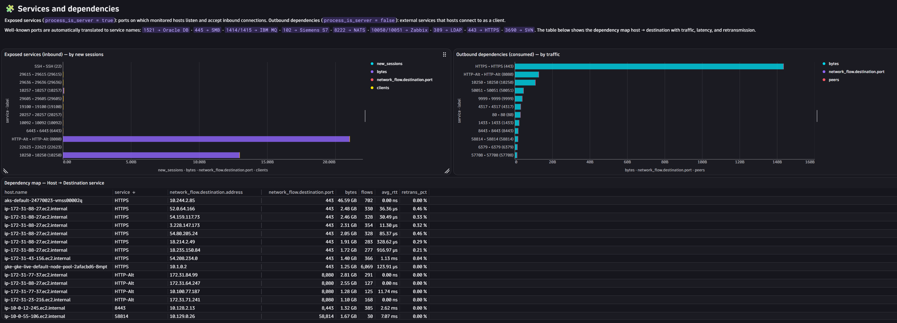
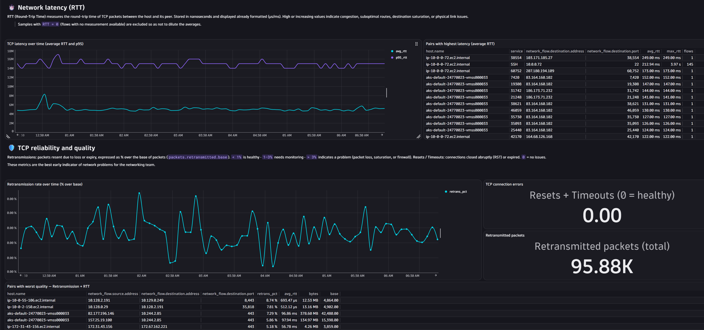
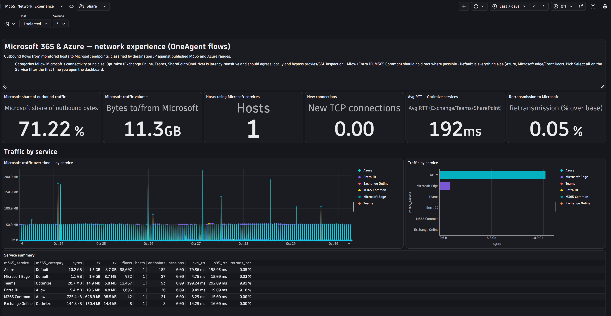

# OneAgent Network Flow Dashboards

Two Dynatrace dashboards built on OneAgent network connection monitoring:

| File | Dashboard |
|---|---|
| Oneagent_Network_Flow_Intelligence_v2.json | Network Flow Intelligence |
| M365_Network_Experience.json | Microsoft 365 & Azure network experience |

## What the dashboards look like

### Network Flow Intelligence

Overview, traffic volume, and top source and destination IPs:

Exposed services, outbound dependencies, and the host-to-destination dependency map:

Latency (RTT) and TCP reliability (retransmissions, resets, timeouts):

### Microsoft 365 & Azure network experience

Microsoft share of outbound traffic, RTT and retransmissions, and traffic by service:

## Prerequisites

- A Dynatrace tenant with the Dashboards app.
- OneAgent 1.337+ on Windows, Linux or AIX.
- Permission to read events from the `default_network_flows` bucket and to read host entities.

## Activate network connection monitoring

The dashboards are empty until OneAgent reports network flows.

1. Go to **Settings > Collect and capture > Infrastructure > Network connection monitoring**.
2. Turn on **Enable OneAgent network connection monitoring**.
3. Under **Reported connections**, choose the level of detail:
   - **Critical** (default): only new sessions that timed out and sessions that were reset. Good for troubleshooting, but most tiles will be sparse.
   - **All**: every connection. Use this for full dependency mapping.
   - **Custom**: thresholds for bytes, connectivity, retransmissions and RTT.
4. Optional: set the **IP filter** (All / Private / Public / custom CIDR include or exclude) to limit what is collected.
5. Save. Flows appear in Grail after the next aggregation interval (default 1 minute).

## Upload a dashboard

1. Open the **Dashboards** app.
2. Select **Upload** and choose one of the JSON files above.
3. Review the dashboard, then **Save** (and **Share** if others need it).
4. Set the timeframe, for example the last 2 hours.
5. Pick a **Host** in the variable at the top. On the M365 dashboard, also open the **Service** variable and choose **Select all** the first time it loads.
